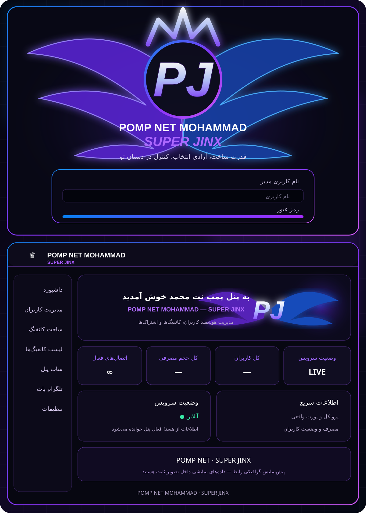
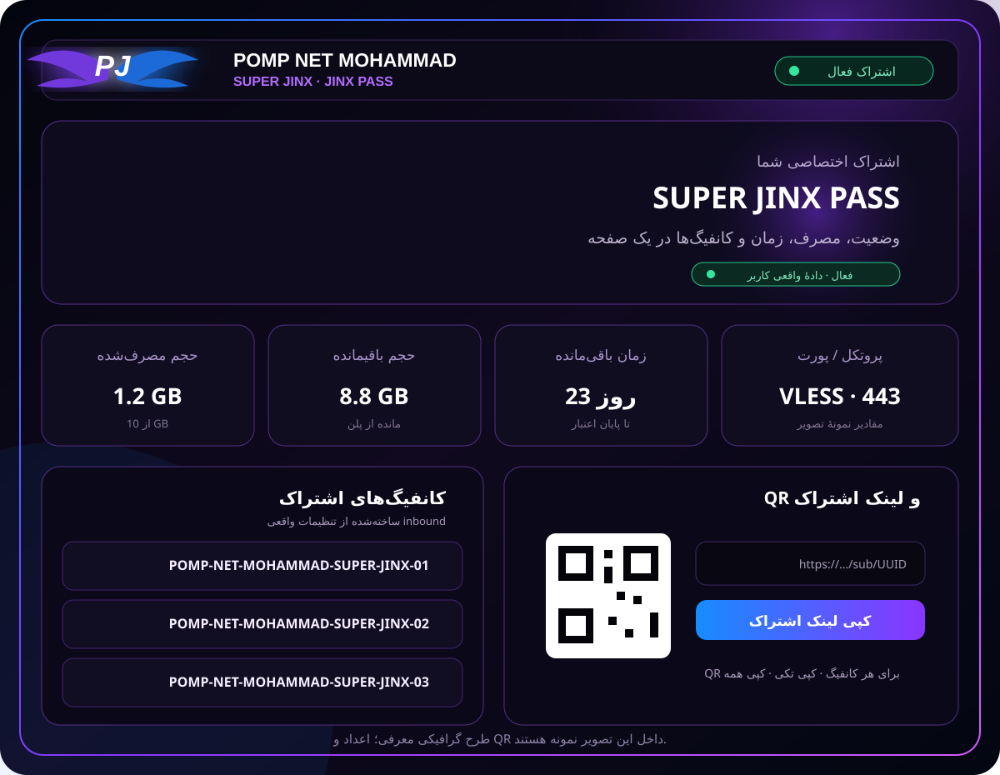
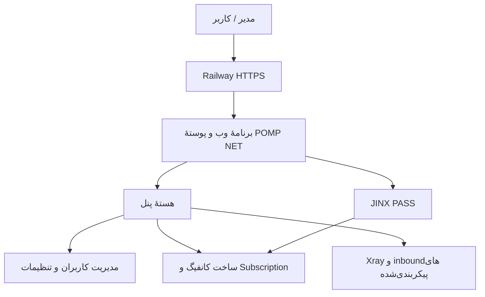

<div align="center">

# ⚡ POMP NET MOHAMMAD
## SUPER JINX · CONTROL CENTER

**پنل مدیریت، ساخت کانفیگ و اشتراک با هویت اختصاصی POMP NET**

قدرت ساخت، آزادی انتخاب، کنترل در دستان تو

[](https://railway.com)
[](https://www.docker.com/)
[](https://www.python.org/)
[](#هویت-و-برند)

[کانال رسمی](https://t.me/pompnet) · [گروه](https://t.me/PompNett) · [پشتیبانی](https://t.me/NovaTunneli) · [وب‌سایت](https://pomp-net.botpool.ai/)

<br>



<sub>پیش‌نمایش گرافیکی رابط ورود و داشبورد؛ مقادیر داخل تصویر نمونهٔ طراحی هستند و آمار نسخهٔ اجرایی از هستهٔ فعال خوانده می‌شود.</sub>

</div>

---

## ✦ دربارهٔ پروژه

**POMP NET MOHAMMAD — SUPER JINX** لایهٔ اجرایی و برندینگ اختصاصی روی نسخهٔ مشخصی از هستهٔ پنل است. هدف پروژه، ارائهٔ تجربه‌ای یکپارچه برای ورود مدیر، مدیریت پنل، مشاهدهٔ اشتراک و دسترسی به کانفیگ‌ها با ظاهر فارسی، واکنش‌گرا و هویت بصری POMP NET است.

> **اصل مهم پروژه:** ظاهر و تجربهٔ کاربری ارتقا پیدا می‌کند؛ اما مسیرهای اصلی، داده‌های کاربران، منطق هسته و اشتراک‌ها نباید با یک تغییر ظاهری جایگزین یا پاک شوند.

## ✨ قابلیت‌ها و وضعیت فعلی

| بخش | وضعیت / توضیح |
|---|---|
| هویت بصری POMP NET / SUPER JINX | پوسته و وصله‌های برندینگ در زمان Build |
| ورود مدیر | مسیر واقعی هسته: `/login` |
| داشبورد مدیریت | داشبورد اصلی هسته: `/dashboard` |
| پیش‌نمایش آماری | `/pompnet-preview`؛ فقط‌خواندنی، نه جایگزین پنل مدیریت |
| اشتراک اصلی | `/sub/{uuid}` |
| صفحهٔ JINX PASS | `/pass/{uid}` و مسیر اصلی سازگاری `/info/{uid}`؛ صفحهٔ اطلاعات و کانفیگ کاربر |
| ربات تلگرام | وصلهٔ هویت نمایشی و نام پیش‌فرض؛ منطق دستورات هسته حفظ می‌شود |
| وضعیت سرویس | `/health` |
| وضعیت Xray | `/api/pompnet/xray` با توکن وضعیت |
| ادغام کامل پروژه‌های مرجع | هنوز تأیید نشده؛ جزئیات در بخش معماری و مرز ادغام |

**توجه:** نمایش یک گزینه یا نام پروتکل در رابط کاربری به‌تنهایی به معنی پشتیبانی فعال آن در inbound، هستهٔ Xray یا شبکهٔ Railway نیست. پروتکل و transport فقط وقتی قابل استفاده‌اند که در هسته و inbound واقعی پیکربندی و آزمایش شده باشند.

## 🧭 مسیرهای مهم

| مسیر | کاربرد |
|---|---|
| `/login` | صفحهٔ ورود |
| `/dashboard` | داشبورد اصلی مدیریت |
| `/pompnet-preview` | پیش‌نمایش آماری فقط‌خواندنی |
| `/sub/{uuid}` | خروجی اشتراک اصلی |
| `/pass/{uid}` | صفحهٔ اختصاصی JINX PASS |
| `/info/{uid}` | مسیر سازگاری صفحهٔ اشتراک |
| `/health` | بررسی سلامت برنامه |
| `/api/pompnet/xray` | وضعیت Xray با توکن اختصاصی |

## 🔗 لینک اشتراک واقعی هر کاربر

مسیر اشتراک در خود برنامه پیاده‌سازی شده و به‌صورت پویا برای هر کاربر از UUID همان حساب ساخته می‌شود:

```text
https://<دامنه-فعال-پنل>/sub/<UUID-واقعی-کاربر>
```

- دامنه باید همان دامنهٔ HTTPS متصل به سرویس Deploy‌شده باشد.
- مقدار UUID باید از حساب واقعی کاربر در پنل گرفته شود؛ این مقدار را نباید حدس زد یا با UUID نمونه جایگزین کرد.
- مسیر بالا قالب مسیر واقعی است، نه یک لینک اشتراک عمومی یا توکن آماده.
- برای دریافت لینک شخصی، وارد پنل شوید، حساب موردنظر را باز کنید و UUID/لینک اشتراک همان حساب را از خود پنل بردارید.
- لینک اشتراک را محرمانه نگه دارید؛ هرکس آن را داشته باشد ممکن است بتواند از اشتراک استفاده کند.
- این مخزن هیچ UUID، رمز یا لینک خصوصیِ ساختگی را به‌عنوان اشتراک فعال منتشر نمی‌کند.

## 💎 صفحهٔ اشتراک JINX PASS

صفحهٔ اختصاصی اشتراک، از همان رکورد کاربر و همان سازندهٔ کانفیگ هسته استفاده می‌کند؛ صفحهٔ جداگانهٔ نمایشی با اطلاعات ساختگی نیست.

<div align="center">



<sub>طرح معرفی JINX PASS؛ مقادیر نمونه در تصویر ثابت‌اند و صفحهٔ اجرایی از رکورد همان کاربر داده می‌خواند.</sub>

</div>

- نمایش وضعیت فعال/غیرفعال، حجم مصرف‌شده، حجم باقیمانده و زمان باقی‌مانده بر اساس اطلاعات همان کاربر
- نمایش پروتکل، پورت، اثر انگشت و محدودیت‌های ثبت‌شده برای همان کانفیگ
- ساخت فهرست کانفیگ‌ها با تابع واقعی تولید کانفیگ هسته و نام‌گذاری `POMP-NET-MOHAMMAD-SUPER-JINX`
- کپی هر کانفیگ، کپی همهٔ کانفیگ‌ها و QR جداگانه برای هر کانفیگ
- لینک اشتراک واقعی `/sub/{uuid}` برای افزودن به کلاینت؛ پورت عمومی HTTPS فقط در صورت تنظیم دامنه/TLS روی 443 است و پورت اختصاصی جدیدی برای مسیر ساب ایجاد نمی‌شود
- مسیر `/pass/{uid}` به‌عنوان نام مستعار صفحهٔ JINX PASS، بدون حذف مسیر `/info/{uid}`

> نکتهٔ فنی: این صفحه فقط قابلیت‌هایی را نمایش می‌دهد که در رکورد و هستهٔ فعلی وجود دارند. نمایش کشور، پینگ یا پروتکل ساختگی اضافه نمی‌شود. فعال‌شدن هر پروتکل جدید نیازمند inbound و generator سازگار و تست اتصال مستقل است.

## 🧩 معماری و مرز ادغام

این مخزن، لایهٔ بسته‌بندی و برندینگ است و هستهٔ پنل را از یک نسخهٔ ثابت دریافت می‌کند. به همین دلیل، همهٔ قابلیت‌های پروژه‌های دیگر را نمی‌توان صرفاً با کپی‌کردن فایل‌های ظاهری به این هسته اضافه کرد.

پروژه‌های مرجع موردنظر:

- [Super JinX](https://github.com/x4gpanell/SuperJinX)
- [MarzbanUpdate](https://github.com/x4gpanell/MarzbanUpdate)

این پروژه‌ها می‌توانند مرجع طراحی تجربهٔ کاربری، صفحهٔ اشتراک و ایده‌های مدیریتی باشند؛ اما **ادغام کامل هسته‌ها و همهٔ قابلیت‌های آن‌ها در این مخزن هنوز انجام‌شده یا تأییدشده نیست**. پیش از هر ادغام باید APIها، مدل داده، وابستگی‌ها، نسخهٔ Xray، مسیرهای اشتراک و مجوز هر جزء جداگانه بررسی و تست رگرسیون اجرا شود.

در این نسخه، الگوهای تجربهٔ کاربری مانند صفحهٔ اشتراک تصویری، فهرست کانفیگ، کپی گروهی و QR با پیاده‌سازی مستقل روی مدل دادهٔ هستهٔ موجود اعمال می‌شوند؛ سورس اختصاصی Super JinX یا هستهٔ MarzbanUpdate به این مخزن کپی/جایگزین نمی‌شود. مجوزها و اعلان‌های اصلی پروژه‌های مرجع باید در نسخه‌های منبع خود باقی بمانند؛ به‌ویژه فایل LICENSE پروژهٔ Super JinX محدودیت بازنشر و بازبرندسازی را اعلام می‌کند و MarzbanUpdate با AGPL-3.0 معرفی شده است.



## 🎨 هویت و برند

- نام محصول: **POMP NET MOHAMMAD — SUPER JINX**
- رنگ پایه: مشکی عمیق `#050509`
- رنگ تأکیدی: بنفش نئونی `#8B35FF`
- رنگ مکمل: آبی `#168CFF`
- زبان رابط: فارسی و راست‌چین، با چیدمان واکنش‌گرا
- شعار: **قدرت ساخت، آزادی انتخاب، کنترل در دستان تو**

برند رابط کاربری و نام‌های نمایشی محصول متعلق به هویت POMP NET هستند. با این حال، فایل‌های LICENSE، NOTICE، اعلان‌های حق‌نشر و انتساب‌های الزامی اجزای بالادستی حذف یا مخفی نمی‌شوند؛ برند رابط کاربری جایگزین تعهدات مجوز نرم‌افزار نیست.

## 🚀 استقرار روی Railway

### ۱. اتصال مخزن
مخزن را در Railway به‌عنوان سرویس Docker متصل کنید و شاخهٔ موردنظر را انتخاب کنید.

### ۲. پورت برنامه
- پورت داخلی پیش‌فرض برنامه: **8080**
- پورت عمومی HTTPS: معمولاً **443** در لبهٔ Railway، پس از فعال‌سازی دامنه و TLS
- مسیر اشتراک `/sub/{uuid}` از همان برنامه و دامنه استفاده می‌کند و پورت جداگانه‌ای در این مسیر تعریف نشده است.

> پورت عمومی HTTPS برابر 443، به معنی پورت inbound یا پورت اختصاصی Xray نیست. پورت و transport هر کانفیگ باید از inbound واقعی خوانده شود.

### ۳. Volume پایدار
یک Volume پایدار به مسیر زیر متصل کنید:

```text
/data
```

قبل از هر تغییر، Volume و داده‌های موجود را بررسی کنید. حذف یا ساخت مجدد Volume ممکن است اطلاعات پنل را از بین ببرد.

### ۴. متغیرهای محیطی

| متغیر | توضیح |
|---|---|
| `PORT` | پورت داخلی برنامه؛ مقدار پیش‌فرض 8080 |
| `DATA_DIR` | مسیر داده؛ مقدار پیشنهادی `/data` |
| `ADMIN_USERNAME` | نام کاربری مدیر |
| `ADMIN_PASSWORD` | رمز قوی و یکتای مدیر |
| `POMPNET_STATUS_TOKEN` | توکن محرمانه برای API وضعیت Xray |

**امنیت ورود:** مقدارهای پیش‌فرض موجود در Dockerfile برای استقرار عمومی امن نیستند. حتماً `ADMIN_USERNAME` و `ADMIN_PASSWORD` را در Railway Variables با مقدارهای قوی تنظیم کنید. رمز واقعی سرویس فعال را نمی‌توان از README یا سورس حدس زد.

### ۵. بررسی پس از استقرار
پس از Deploy این موارد را جداگانه بررسی کنید:

1. Build و اجرای کانتینر
2. پاسخ مسیر `/health`
3. ورود مدیر و بازشدن `/dashboard`
4. ساخت کاربر آزمایشی و انتخاب inbound واقعی
5. دریافت `/sub/{uuid}` و بازشدن JINX PASS
6. تست QR، کپی و افزودن اشتراک در کلاینت
7. اتصال واقعی هر پروتکل از شبکهٔ موردنظر
8. باقی‌ماندن داده‌ها پس از Restart

## 🔐 حفظ داده و امنیت

- هسته و مسیرهای اصلی را با یک صفحهٔ نمایشی جایگزین نکنید.
- Volume فعلی را بدون تهیهٔ نسخهٔ پشتیبان حذف نکنید.
- رمز مدیر و توکن وضعیت را در کد یا README قرار ندهید.
- لینک اشتراک هر کاربر محرمانه است؛ آن را عمومی منتشر نکنید.
- فعال‌بودن یک پروتکل در منو، جایگزین تنظیم inbound و تست اتصال نیست.
- موفقیت Docker Build به‌تنهایی سلامت ورود، اتصال Xray یا عملکرد تمام کانفیگ‌ها را ثابت نمی‌کند.

## 🧪 وضعیت تست

وضعیت لحظه‌ای Build و بررسی‌های خودکار را از صفحهٔ زیر ببینید:

[مشاهده GitHub Actions](https://github.com/uxurx7rh7e7xr73uue73e8/-MohammadAmir-PompNet-Panel/actions)

چک‌لیست انتشار:

- [ ] Build ایمیج Docker موفق
- [ ] اجرای کانتینر و پاسخ `/health`
- [ ] ورود موفق به داشبورد اصلی
- [ ] ساخت کاربر آزمایشی
- [ ] دریافت اشتراک واقعی
- [ ] تست QR و افزودن در کلاینت
- [ ] تست اتصال واقعی هر inbound و پروتکل
- [ ] تأیید ماندگاری داده پس از Restart

## 🛠️ ساختار اجرایی مهم

| فایل | نقش |
|---|---|
| `Dockerfile` | ساخت ایمیج و اجرای برنامه |
| `railway.json` | تنظیمات استقرار Railway |
| `app_wrapper.py` | لایهٔ راه‌اندازی و مسیرهای کمکی |
| `pompnet_brand.py` | وصله‌های برندینگ |
| `pompnet_jinx_ui.py` | تغییرات رابط JINX PASS |
| `pompnet_integrations_brand.py` | وصله‌های هویت و نام کانفیگ در ادغام‌ها |
| `README.md` | راهنمای پروژه |

## 🤝 پشتیبانی و ارتباط

<div align="center">

**POMP NET MOHAMMAD — SUPER JINX**

[کانال تلگرام](https://t.me/pompnet) · [گروه تلگرام](https://t.me/PompNett) · [پشتیبانی](https://t.me/NovaTunneli)

[وب‌سایت رسمی](https://pomp-net.botpool.ai/) · [سازمان GitHub](https://github.com/uxurx7rh7e7xr73uue73e8)

</div>

---

<div align="center">

**ساخته‌شده برای تجربه‌ای حرفه‌ای‌تر؛ با حفظ هسته، داده‌ها و شفافیت فنی.**

</div>
